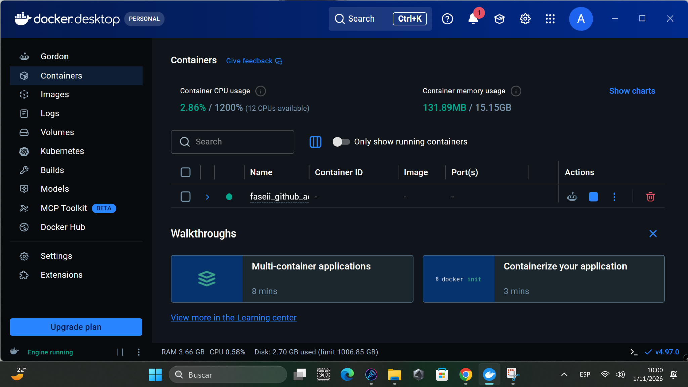
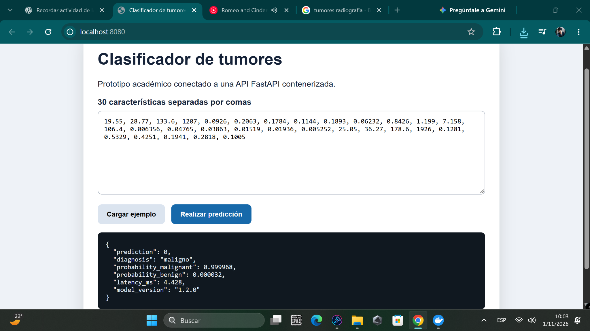

# Evidencia de ejecución local

## Docker

Motor Docker activo y proyecto Compose en ejecución en el equipo del estudiante.

## Predicción desde la interfaz

La interfaz en http://localhost:8080 devolvió clase 0 (maligno), probabilidad de malignidad 0.999968, latencia 4.428 ms y versión 1.2.0 para el ejemplo mostrado. La probabilidad es una estimación del modelo para ese ejemplo académico.

Las capturas confirman el flujo interfaz–API–modelo. La salida de las pruebas automáticas del iniciador queda pendiente de revisión; no se declara que hayan pasado dentro del contenedor. La publicación de este paquete en GitHub debe realizarse por separado.
